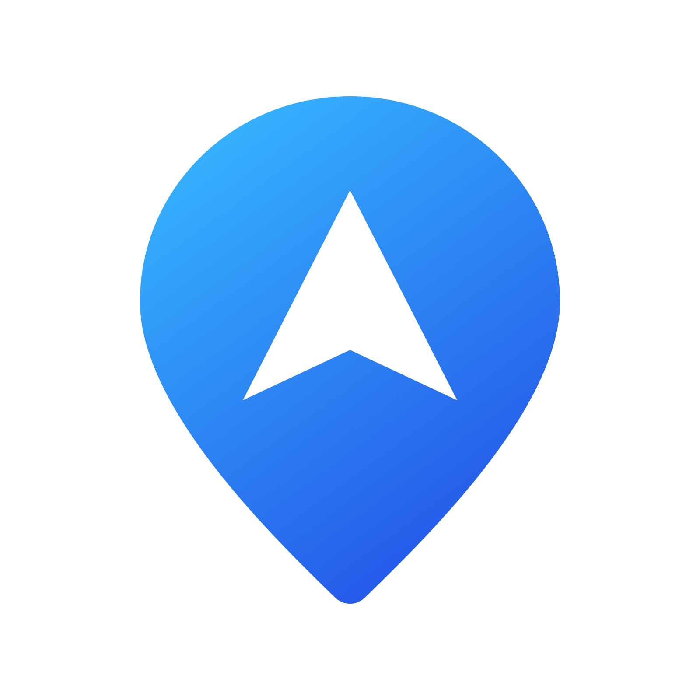

<div align="center">
  
  <h1>Agent Intelligence</h1>
  <p>A field agent activity monitoring and management app.</p>

  
  
  
  
  
  
  
</div>

---

## ✨ About

**Agent Intelligence** helps agents and teams monitor field activities in one app. Agents can view tasks and update their profiles, while their locations and statuses can be monitored on a map.

### Key features

- 📍 **Agent location tracking** — location updates continue in the background on Android with a persistent service notification.
- 🗺️ **Maps and offices** — view agent locations and office listings on a map.
- 👥 **Team monitoring** — view agent lists, profiles, and presence statuses.
- ✅ **Task management** — view agent tasks and update their progress.
- 🔔 **Push notifications** — receive Firebase Cloud Messaging notifications on Android.
- 🖼️ **Agent profiles** — update profile information and photos.
- 🆕 **Release notes** — view the app changelog from the dashboard.

## 🧰 Tech stack

| Area | Technologies |
| --- | --- |
| Mobile app | Flutter, Dart |
| Maps and location | `flutter_map`, `geolocator`, `geocoding` |
| Backend API | Node.js, Express |
| Database | Oracle Database |
| Android notifications | Firebase Cloud Messaging, local notifications |
| Task storage | JSON |

## 🚀 Getting started

### Prerequisites

- Flutter SDK and Dart SDK compatible with the constraints in [`pubspec.yaml`](pubspec.yaml)
- Android Studio or an Android device to run the app
- Node.js and access to an Oracle Database to run the backend

### Flutter app

```powershell
flutter pub get
flutter run
```

Firebase for Android is configured for this project. When testing on a device, make sure the app has the required location and notification permissions.

### Backend

The backend requires an Oracle connection. Set the following environment variables in `backend/.env` before starting it:

```dotenv
PORT=3000
ORACLE_USER=username
ORACLE_PASSWORD=password
ORACLE_CONNECT_STRING=host:port/service_name
```


```powershell
cd backend
npm install
node server.js
```

Run the backend tests with:

```powershell
npm test
```

## 📍 Android location tracking

Tracking starts automatically after login and uses a foreground location service with a persistent notification while active. Updates continue while the app is in the background or the screen is locked. An agent is marked offline after 2 minutes without a location update and returns online when the next update is received. Android may still stop the process if the app is force-stopped or the device applies battery restrictions.

## 🔔 Android push notifications (FCM)

Firebase and FCM are initialized when the Android app starts. Android requests notification permission; notifications received while the app is open are shown as local notifications, and FCM notifications with a `notification` payload are displayed automatically when the app is in the background. APNs must be configured separately for iOS.

To test manually, send a test message from the Firebase Console to the device's FCM token. The token is only printed when the app is built with `--dart-define=LOG_FCM_TOKEN=true`; **do not use this option for APKs distributed publicly**:

```powershell
flutter build apk --release --dart-define=LOG_FCM_TOKEN=true
adb logcat -s flutter
```

Copy the token from the local log into the **Send test message** feature in the Firebase Console. Regular public builds omit `--dart-define`, so the token is not printed. The Firebase Console is suitable for manual testing; automated or targeted messaging requires a trusted backend that sends messages using the Firebase Admin SDK or Cloud Functions. Never store Admin SDK credentials in the Flutter app.

## 🆕 App changelog

The latest changelog is shown once when the app is first opened or whenever its version/build changes. Users can reopen it from the **What's new?** icon on the dashboard. Only the latest release notes are kept; update `latestEntries` in [`lib/services/changelog_service.dart`](lib/services/changelog_service.dart) for the next release and increment the version/build number in [`pubspec.yaml`](pubspec.yaml).

## 📦 Building an Android release APK

Release APKs must be signed with the app owner's key. Create the key once and store it outside the repository; NEVER share or commit the key file or its password:

```powershell
keytool -genkey -v -keystore "$env:USERPROFILE\agent-tracker-upload-key.jks" -keyalg RSA -keysize 2048 -validity 10000 -alias upload
```

Copy `android/key.properties.example` to `android/key.properties`, then enter the password and absolute path to the generated `.jks` file. The key and `key.properties` files are ignored by Git. Build a public APK without diagnostic flags:

```powershell
flutter build apk --release
```

The APK is available at `build/app/outputs/flutter-apk/app-release.apk`. Users with a build signed using a different key (such as a debug build) must uninstall it before installing this APK. Future APK updates must use the same signing key.

The current application ID is `com.example.agent_inteligence`, which matches the existing Firebase configuration. It is retained for direct APK testing; before long-term public distribution, replace it with a unique application ID and register the same ID as an Android app in Firebase.


Agent Intelligence Tracker made with ❤ by senzxc.
